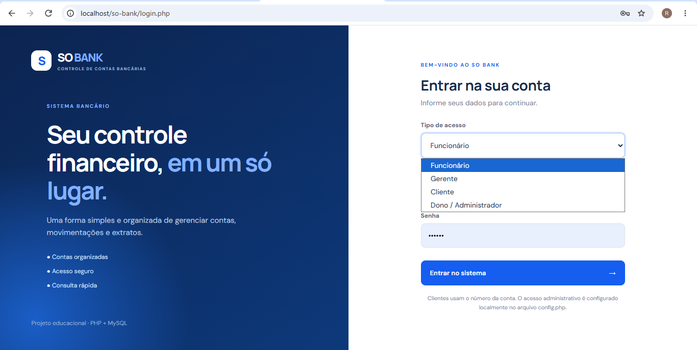
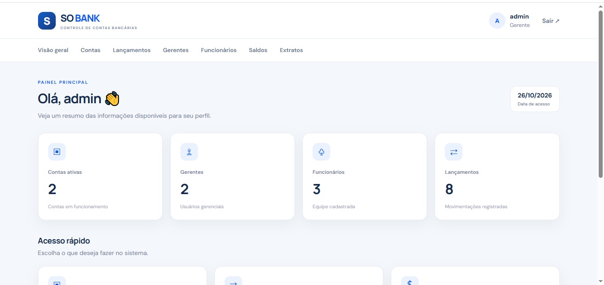
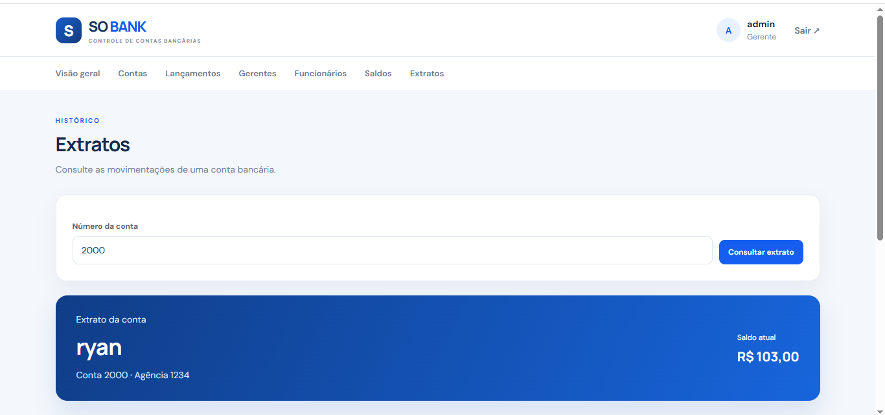

# 🏦 SO BANK

### Sistema Bancário Web

Sistema bancário desenvolvido como projeto acadêmico, com foco em desenvolvimento web, gerenciamento de contas e movimentações financeiras.

**PHP · MySQL · HTML5 · CSS3**

---

## 📌 Sobre o projeto

O **SO BANK** é um sistema bancário web desenvolvido para aplicar conhecimentos de programação, banco de dados e desenvolvimento de interfaces.

O projeto possui diferentes áreas de acesso, de acordo com o tipo de usuário, e reúne funcionalidades relacionadas ao gerenciamento de contas e operações bancárias.

## ✨ Funcionalidades

- 🔐 Sistema de autenticação de usuários.
- 👤 Gerenciamento de clientes e contas.
- 👨‍💻 Gerenciamento de funcionários.
- 🧑‍💼 Gerenciamento de gerentes.
- 💰 Registro de depósitos e saques.
- 📊 Consulta de saldos.
- 📄 Consulta de extratos e movimentações.
- 🏦 Painel de gerenciamento do sistema.

*As funcionalidades disponíveis dependem do perfil de acesso do usuário.*

## 🛠️ Tecnologias utilizadas

| Tecnologia | Utilização |
|---|---|
| PHP | Lógica e processamento do sistema |
| MySQL | Armazenamento de dados |
| HTML5 | Estrutura das páginas |
| CSS3 | Estilização e interface |
| XAMPP | Ambiente de desenvolvimento local |
| phpMyAdmin | Administração do banco de dados |
| GitHub | Versionamento e apresentação do projeto |

## ⚙️ Como executar o projeto

### 1. Instale os requisitos

Instale o [XAMPP](https://www.apachefriends.org/pt_br/index.html), que fornece o Apache e o MySQL para executar o projeto localmente.

### 2. Baixe o projeto

Clone o repositório ou baixe seus arquivos pelo GitHub.

### 3. Configure o ambiente

Coloque a pasta do projeto dentro do diretório `htdocs` do XAMPP.

Exemplo:

`C:\xampp\htdocs\so-bank\`

### 4. Configure o banco de dados

- Inicie o Apache e o MySQL no XAMPP.
- Abra o phpMyAdmin.
- Configure o banco de dados conforme a estrutura utilizada pelo projeto.
- Copie `config.example.php` para `config.php`.
- Ajuste as configurações locais de conexão com o MySQL.

**Importante:** utilize as configurações correspondentes ao seu ambiente. Não publique senhas ou credenciais administrativas no repositório.

### 5. Acesse o sistema

Abra o navegador e acesse:

`http://localhost/so-bank/`

Se a pasta tiver outro nome ou estiver em outro caminho, ajuste o endereço conforme a instalação.

## 🎯 Objetivos de aprendizagem

Este projeto permite praticar:

- Desenvolvimento de aplicações web com PHP.
- Integração entre PHP e MySQL.
- Operações de consulta e manipulação de dados.
- Organização de arquivos e componentes reutilizáveis.
- Construção de interfaces com HTML e CSS.
- Controle de acesso por perfil de usuário.

## 📚 Contexto do projeto

Projeto acadêmico desenvolvido para consolidar conhecimentos na área de Tecnologia da Informação, com foco em programação web e bancos de dados.

## 🔒 Segurança

Este repositório é destinado à apresentação do projeto e ao aprendizado.

- Não publique senhas reais.
- Não envie arquivos de configuração com credenciais privadas.
- Não utilize dados bancários ou pessoais reais em demonstrações.
- Antes de utilizar o sistema em um ambiente real, implemente e valide os controles de segurança necessários.

---

**SO BANK — Projeto acadêmico de desenvolvimento web.**

Desenvolvido por RYANSTACK 💻

## 📸 Demonstração do sistema

### 🔐 Tela de login

### 📊 Painel principal

### 💳 Extratos

